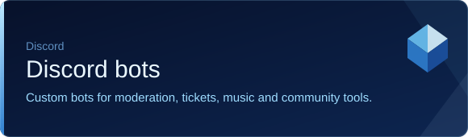
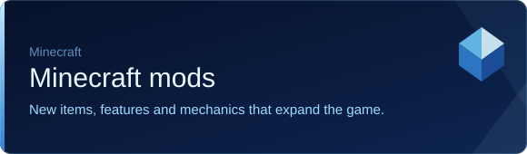
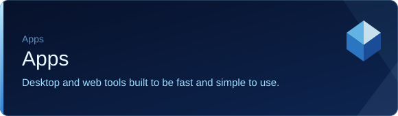

  

 

I build **Discord bots**, **Minecraft mods**, **assistants** and **apps**.

**Want something built or a bot in your server?** Message `vertexmaybefound` on Discord.

### What I make

<table>
  <tr>
    <td width="50%"></td>
    <td width="50%"></td>
  </tr>
  <tr>
    <td width="50%"></td>
    <td width="50%"></td>
  </tr>
</table>

  Vertex’s Creations

